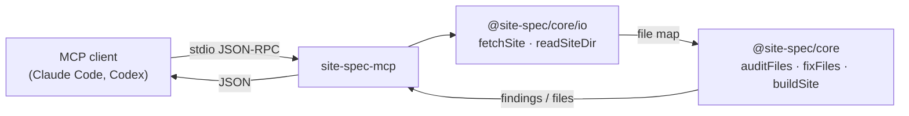

# site-spec-mcp

> Give your coding agent eyes for the layer it can't see: the MCP server for
> [site-spec](https://github.com/ariaxhan/site-spec).

[](https://www.npmjs.com/package/site-spec-mcp)
[](./LICENSE)

AI can generate a beautiful website in seconds. The part it *can't* see is the
machine-readable foundation underneath the pixels — `robots.txt`, structured
data, `llms.txt`, canonical and `noindex` signals, response headers,
accessibility semantics, the tracker and cookie surface — which is the part that
decides whether the site gets found, ranked, cited, and trusted.

This server hands that layer to your agent as four tools. It runs the same
deterministic engine as the `site-spec` CLI, in-process: no network hop to a
hosted service, no shelling out, no model in the loop deciding what counts as
broken.

## Install

```bash
claude mcp add site-spec -- npx -y site-spec-mcp
```

<details>
<summary>Codex (<code>~/.codex/config.toml</code>)</summary>

```toml
[mcp_servers.site-spec]
command = "npx"
args = ["-y", "site-spec-mcp"]
```

</details>

<details>
<summary>Any other MCP client (<code>mcp.json</code>-style)</summary>

```json
{
  "mcpServers": {
    "site-spec": {
      "command": "npx",
      "args": ["-y", "site-spec-mcp"]
    }
  }
}
```

</details>

Requires Node 20+. No account, no API key, no SaaS. The published package is a
single bundled file with zero runtime dependencies.

## The tools

| Tool | What it does |
| --- | --- |
| `audit_site` | Crawl a live URL (or read a local build directory) and return every finding: check id, severity, file, and whether it can be auto-fixed. |
| `fix_issue` | Apply the deterministic repair for one check id and return the diff — or write it, for a local directory. |
| `compile_spec` | Turn verified business facts into a validated SiteSpec and the deployable files it renders to. |
| `list_checks` | Enumerate every check the engine can raise, with a one-line description and its fix availability. |

### How a tool call reaches the engine



The server never shells out to the `site-spec` CLI and never calls the hosted
worker. Both are consumers of the same engine, not layers underneath this one.

## Notes on honesty

**`fix_issue` on a URL can only ever give you a diff.** The fix engine is pure:
it returns corrected file contents and never touches disk or network. A remote
server is not writable, so `write: true` is refused for a URL target. Point it
at the local directory that produces the site to actually apply a fix.

**A live crawl runs presence checks off.** A capped crawl cannot prove a file is
absent from a server, so `audit_site` disables link/presence checks in URL mode
— otherwise it would invent "missing" findings for pages it simply didn't fetch.
Local directory audits run the full set.

**Not every check is fixable.** 17 of the 40 checks have a deterministic repair;
the rest need a human, and `fix_issue` says so rather than guessing. `list_checks`
marks which is which.

## Also available

- **CLI**: `npx site-spec audit https://yoursite.com` — the full check set,
  including broken links, axe accessibility, and HTML validation.
- **Hosted**: [site-spec.ariaxhan.workers.dev](https://site-spec.ariaxhan.workers.dev)
  — paste a URL, get the report, no install.

## License

Apache-2.0 © Aria Han
